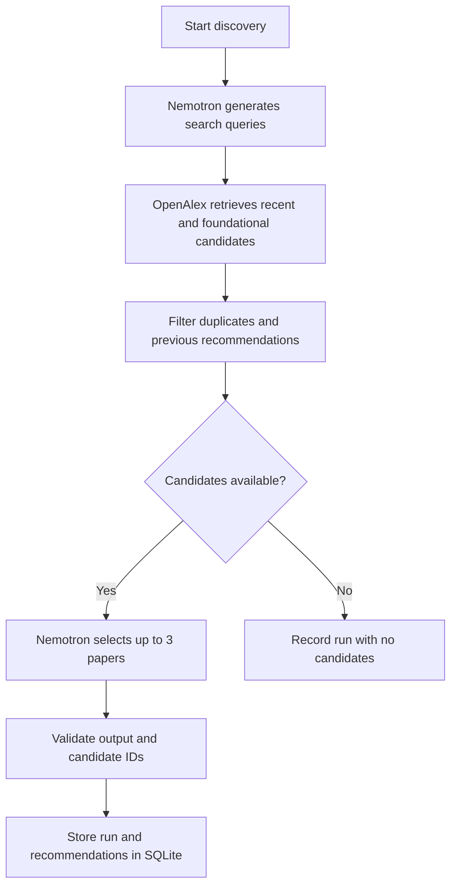

# Research Desk

**An AI research agent system in development.**

Research Desk is being built to help me go beyond collecting research papers and actually understand them. The goal is a system that can discover relevant work, investigate full papers, explain difficult ideas without losing the technical meaning, examine claims against evidence, and connect new findings to research I've already explored.

The first working part is **research discovery**. Paper analysis, research memory, and the broader agent workflow come next.

## What I'm building

The longer-term system is designed to:

- **Discover research:** find relevant recent and foundational papers, rather than relying on recency alone.
- **Read and explain papers:** make methods, results, and technical ideas understandable in both plain language and a deeper technical breakdown.
- **Interrogate the evidence:** keep four things separate: what the authors report, what the evidence supports, outside context, and the agent's own inferences.
- **Connect research over time:** identify useful relationships across papers, including shared methods, extensions, disagreements, and open questions.
- **Maintain a research library:** make completed analyses available in Notion and a local Obsidian vault, with retrieval across past work.

These are **design goals**, not a list of completed features. The fuller design is documented in [docs/ARCHITECTURE.md](docs/ARCHITECTURE.md).

## What works today

### Research discovery

The current Python/LangGraph workflow runs end to end:

1. **Nemotron** generates two search queries: one for recent Agentic AI research and one for foundational work.
2. **OpenAlex** retrieves candidate papers and their metadata.
3. The application removes duplicate candidates and papers already recommended in earlier runs.
4. **Nemotron** selects up to three papers from those candidates and explains why each is worth reading.
5. **Pydantic** validates the model's structured output, and the application verifies that recommended paper IDs came from the retrieved candidates.
6. **SQLite** records the run, paper metadata, and recommendations for use across runs.



The model makes decisions about search terms and paper selection. API requests, filtering, validation, and persistence are controlled by application code. This is a bounded discovery workflow, not yet an autonomous paper-reading agent.

### Model evaluation

The separate `brain/` subsystem supports experiments for evaluating how language models read and explain research papers. It includes PDF parsing with Docling, a repeatable question-and-full-paper-analysis runner, saved responses and run metadata, and a report extractor. This work informs model selection for the larger agent; it is **not yet integrated into the discovery workflow**.

See [brain/EVALUATION.md](brain/EVALUATION.md) for the evaluation goals.

## Run the discovery workflow

### Requirements

- Python 3.10 or newer (developed on 3.13) and `pip`
- An [OpenRouter](https://openrouter.ai/) API key
- Internet access for OpenRouter and OpenAlex requests

From the repository root:

```bash
python -m venv .venv
```

Activate the environment:

```powershell
# Windows PowerShell
.\.venv\Scripts\Activate.ps1
```

```bash
# macOS / Linux
source .venv/bin/activate
```

Install dependencies:

```bash
python -m pip install -r requirements.txt
```

This also installs Docling and PyTorch for the `brain/` experiments, so the first install is large.

Create a `.env` file in the repository root:

```dotenv
OPENROUTER_API_KEY=your_api_key_here
```

Run discovery:

```bash
python -m research_desk discover
```

The command prints the selected papers, source links, and reasons for reading them. By default, the SQLite database is stored at `data/research_desk.db`. You can choose a different database file with `--db`:

```bash
python -m research_desk discover --db path/to/research_desk.db
```

Each run skips papers recommended in earlier runs, so repeated runs can end with no new candidates once the search results are used up.

The discovery workflow currently uses `nvidia/nemotron-3-super-120b-a12b:free` through OpenRouter. Free-model availability and provider limits may affect live runs. There are no automatic retries: if OpenRouter or OpenAlex rate-limits or times out, the run is recorded as failed and can be rerun later. The application requires this configured free model for discovery; it does not silently substitute another model.

Run the test suite:

```bash
python -m unittest discover -s tests -v
```

## Project structure

```text
research-agent/
├── research_desk/       # LangGraph discovery workflow, API clients, storage, CLI
├── brain/               # Separate paper parsing and model-evaluation experiments
├── docs/                # System architecture
├── tests/               # Automated tests
├── requirements.txt
└── README.md
```

Local data, experiment outputs, original research PDFs, and credentials are excluded from Git where specified in `.gitignore`.

## Current limits and next work

The discovery workflow currently searches Agentic AI literature using titles, abstracts, and bibliographic metadata. It does not download and analyze the full text of those selected papers, decide autonomously which tools to call, or connect research across an indexed library. Notion and Obsidian integration are also planned rather than implemented.

The immediate work is to **evaluate recommendation quality**: a completed run does not establish that the selected papers are genuinely useful. From there, the project will extend toward full-paper acquisition and analysis, connected research memory, and an agent workflow that can investigate a question further when the available evidence is insufficient.
